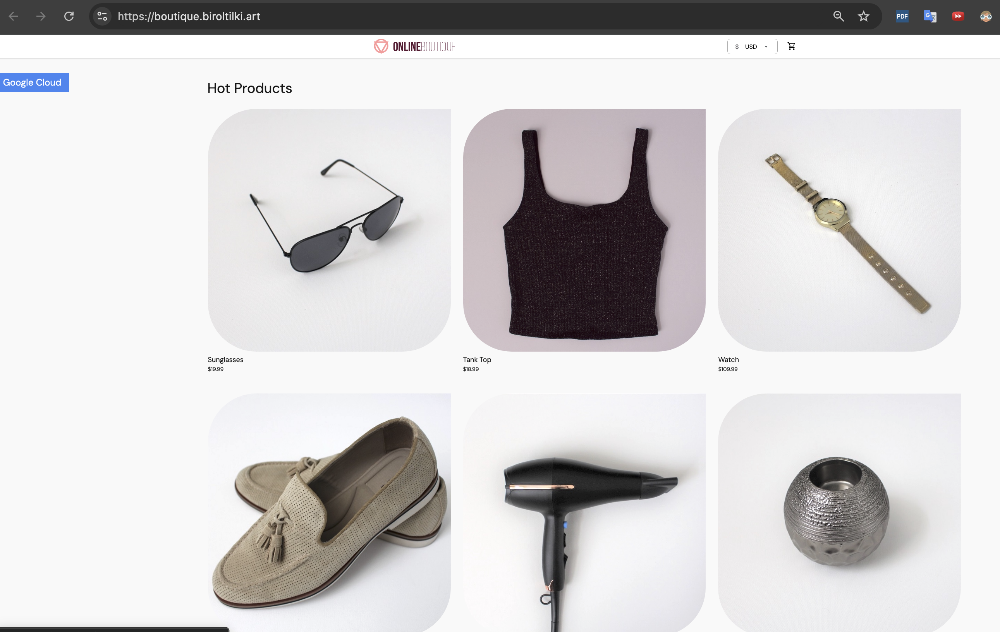
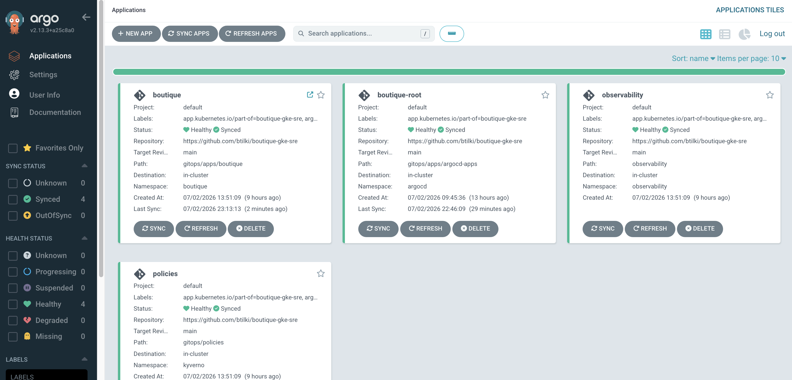
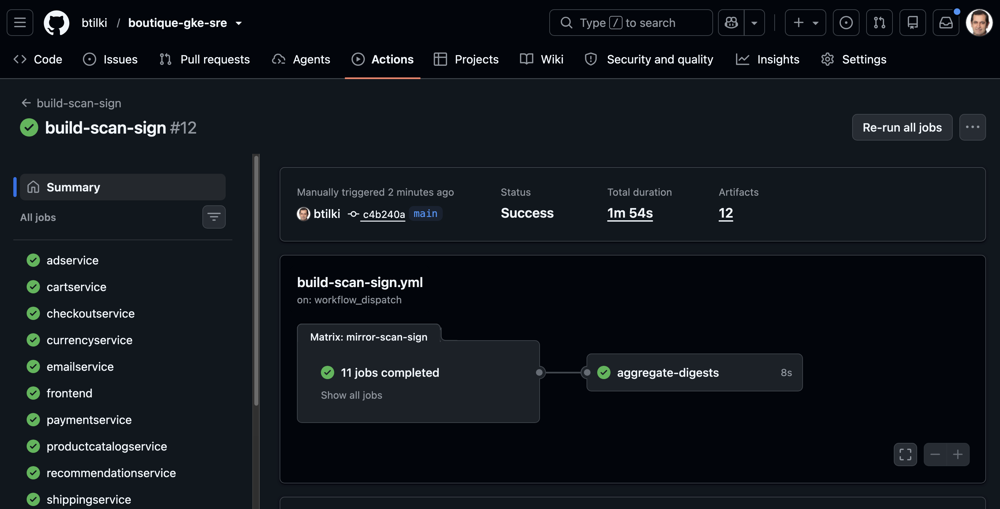
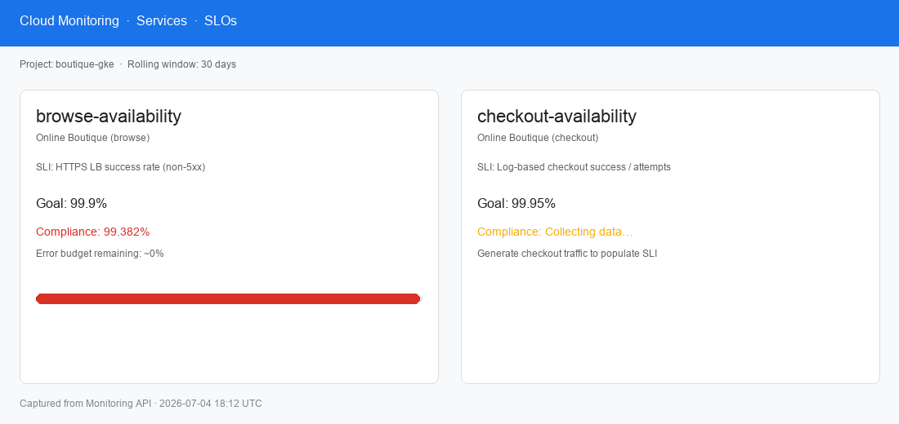
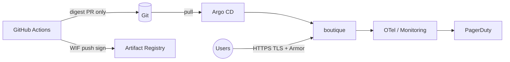
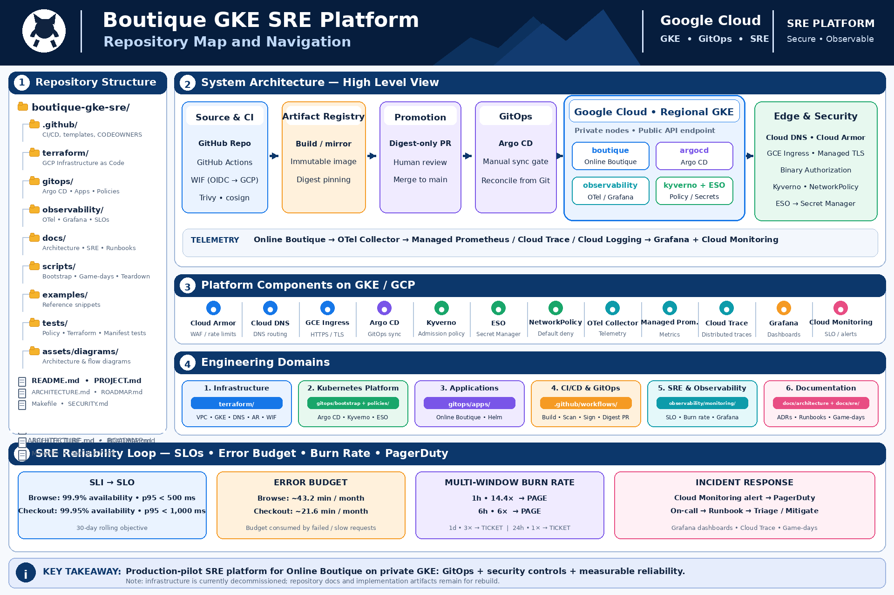

# boutique-gke-sre

Production-pilot SRE platform for [Google Online Boutique](https://github.com/GoogleCloudPlatform/microservices-demo) on private GKE — SLOs, burn-rate alerts, PagerDuty, GitOps.

> **Status:** Production pilot closed. Phases 1–8 ran end to end; then the GCP resources were destroyed. There is no live GKE cluster or public DNS from that run. To run again, follow [`docs/setup/`](docs/setup/) (topics 01–16).

Author: [Birol Tilki](https://www.linkedin.com/in/birol-tilki-48731326/)

**Hostnames (offline until rebuild):** `boutique.biroltilki.art` · `argocd.boutique.biroltilki.art`

---

## Problem

Shipping Online Boutique to a cluster is not the hard part. The hard part is reliability **after deployment**. You need to know when browse or checkout is burning error budget, route that signal to a human with a runbook, and prove the supply chain did not leave `:latest` or unsigned images in the path. A Terraform apply alone does not prove that story.

## Decision

- **One private regional GKE cluster** in project `boutique-gke` — namespaces for isolation, not multi-cluster blast radius ([ADR-001](docs/adr/001-single-cluster.md)).
- **Git is what Argo CD reconciles** — GitHub Actions builds, scans (Trivy), signs (cosign), and opens digest PRs. Operators sync Argo by hand ([ADR-003](docs/adr/003-manual-argocd-sync.md)).
- **Admission blocks the easy mistakes** — Kyverno enforces digest-only images, probes, resources, NetworkPolicy labels, and ESO-only secrets. Binary Authorization checks attestations when the cluster admits images.
- **SRE after deployment** — browse and checkout SLOs in Cloud Monitoring, multi-window burn alerts, PagerDuty with runbook links, game days, and ordered teardown.

## Result

Topics 01–16 completed, then teardown. Documentation and screenshots remain; there are no public A records. File-backed claims: [`docs/pilot-claims.md`](docs/pilot-claims.md).

---

## At a glance

|           |                                                                                                        |
| --------- | ------------------------------------------------------------------------------------------------------ |
| What      | SRE-focused private GKE for Online Boutique in `europe-west1`                                          |
| Hard rule | Reliability **after deployment** — SLOs → burn alerts → PagerDuty → runbooks                           |
| CI model  | GitHub Actions + WIF; **CI does not sync Argo** — digest PRs only                                      |
| Scope     | Production pilot — one project, one cluster; not multi-region HA                                       |
| Stack     | Terraform · GKE · Argo CD · Kyverno · ESO · Binary Authorization · OTel · Cloud Monitoring · PagerDuty |

---

## Proof

These screenshots are from the lived pilot. Full catalog: [`docs/evidence/`](docs/evidence/README.md). Hostnames stay offline until you rebuild.

**Storefront** — `https://boutique.biroltilki.art` over HTTPS (when the pilot was live):



**Argo CD** — Applications Healthy / Synced:



**GitHub Actions** — `build-scan-sign` succeeded (Trivy → push → cosign):



**SLOs** — browse and checkout availability in Cloud Monitoring:



More: Kyverno, Binary Authorization, PagerDuty test incident, Grafana, Cloud Trace, Cloud Armor — [`docs/evidence/`](docs/evidence/README.md).

---

## Tradeoffs / what I would change for real production

- **Public Kubernetes API endpoint** — nodes are private; the control plane is not. A rebuild would set a private endpoint and master authorized networks ([`SECURITY.md`](SECURITY.md)).
- **Single cluster, one Boutique namespace** — fine for a cost-capped pilot; not true env isolation.
- **`redis-cart` attestation gap** — the game day showed Binary Authorization blocking an unsigned restore; postmortem actions are still open.
- **Storefront Cloud Armor is a console procedure** — Terraform Armor covers the Argo CD policy only when enabled; the storefront WAF was topic 15 by hand.
- **NetworkPolicy may not be enforced by the CNI** — Kyverno requires the label; the GKE module does not pin Dataplane V2 or Calico.

Do **not** call this production-ready. Limits: [`SECURITY.md`](SECURITY.md). Lessons: [`docs/lessons-learned.md`](docs/lessons-learned.md).

---

## Where to start

| I want to…                            | Read                                                                                                                                                                                                                                                                |
| ------------------------------------- | ------------------------------------------------------------------------------------------------------------------------------------------------------------------------------------------------------------------------------------------------------------------- |
| Understand the project in ~10 minutes | This page → [`ARCHITECTURE.md`](ARCHITECTURE.md) → [ADR-003](docs/adr/003-manual-argocd-sync.md)                                                                                                                                                                    |
| See pilot proof                       | [`docs/pilot-claims.md`](docs/pilot-claims.md) · [`docs/evidence/`](docs/evidence/README.md)                                                                                                                                                                        |
| Review design and SRE                 | [`docs/architecture/overview.md`](docs/architecture/overview.md) · [`docs/sre/`](docs/sre/README.md) · [`docs/ci.md`](docs/ci.md) · [`docs/security/threat-model.md`](docs/security/threat-model.md) · [`docs/operations/rollback.md`](docs/operations/rollback.md) |
| Rebuild or operate                    | [`docs/setup/`](docs/setup/README.md) (topics 01–16) · [`docs/teardown.md`](docs/teardown.md) · [`docs/operations/operations-runbook.md`](docs/operations/operations-runbook.md)                                                                                    |

Full index: [`docs/README.md`](docs/README.md)

---

## Stack flow (summary)



Manual Argo sync after merge. Details: [`ARCHITECTURE.md`](ARCHITECTURE.md) · [`docs/architecture/overview.md`](docs/architecture/overview.md).

---

## Repository map and navigation

This map shows repository layout, platform components, and where each area lives.



Full tree: [`REPOSITORY_STRUCTURE.md`](REPOSITORY_STRUCTURE.md)

---

## What the pilot demonstrated

- Private-node GKE with HTTPS on the storefront and Argo CD hostnames (when live)
- Digest-only GitOps, Kyverno baseline, ESO + Secret Manager, Binary Authorization
- Browse and checkout SLOs, burn-rate alerts, PagerDuty test path, one executed game day
- Ordered teardown with orphan-resource scans ([`docs/teardown.md`](docs/teardown.md))

---

## Technology stack

| Area                | Choices                                                                          |
| ------------------- | -------------------------------------------------------------------------------- |
| Cloud / region      | GCP `europe-west1`, project `boutique-gke`                                       |
| IaC                 | Terraform ≥ 1.5                                                                  |
| Kubernetes          | Regional private-node GKE, Workload Identity                                     |
| GitOps / delivery   | Argo CD (manual sync), Helm                                                      |
| Policy / secrets    | Kyverno, ESO, Secret Manager, NetworkPolicy                                      |
| Ingress / TLS       | Google-managed certs, static IP, Cloud Armor                                     |
| CI / supply chain   | GitHub Actions, WIF, Artifact Registry, Trivy, cosign, Binary Authorization      |
| Observability / SRE | OTel, Cloud Trace, Managed Prometheus, Grafana, Cloud Monitoring SLOs, PagerDuty |

---

## Repository layout

```text
boutique-gke-sre/
├── terraform/       # GCP IaC (networking, GKE, WIF, AR, Binary Auth, …)
├── gitops/          # Argo CD apps, Kyverno, NetworkPolicy, Boutique Helm
├── observability/   # OTel, Grafana, SLO / alert YAML
├── docs/            # Setup topics, SRE runbooks, security, architecture
├── scripts/         # Bootstrap checks, game days, teardown helpers
├── tests/           # Policy and manifest validation
└── .github/         # CI workflows (WIF)
```

---

## Quick clone

```bash
git clone https://github.com/btilki/boutique-gke-sre.git
cd boutique-gke-sre
```

Do not provision GCP from this file. Bootstrap and destroy live under [`docs/setup/`](docs/setup/) and [`docs/teardown.md`](docs/teardown.md). Validate local CLI with `./scripts/bootstrap/validate-prereqs.sh`.

---

## Contributing · License · Related

- Contributing: [`CONTRIBUTING.md`](CONTRIBUTING.md)
- Security: [`SECURITY.md`](SECURITY.md)
- Roadmap: [`ROADMAP.md`](ROADMAP.md)
- License: [`LICENSE`](LICENSE) (Apache 2.0)

| Repository             | Link                                                      |
| ---------------------- | --------------------------------------------------------- |
| Google Online Boutique | https://github.com/GoogleCloudPlatform/microservices-demo |
| boutique-eks-gitops    | https://github.com/btilki/boutique-eks-gitops             |
| boutique-aks-devsecops | https://github.com/btilki/boutique-aks-devsecops          |
