# Pilot evidence — boutique-gke-sre

Screenshots from the production pilot while it was live. The GKE cluster and other GCP billables were destroyed afterward (Phase 8). There is no live demo today. These images are the proof that the path ran once.

Files sit under [`assets/diagrams/`](../../assets/diagrams/). The README [Proof](../../README.md#proof) section shows a short crop of the same set.

---

## Captured

### Storefront — HTTPS

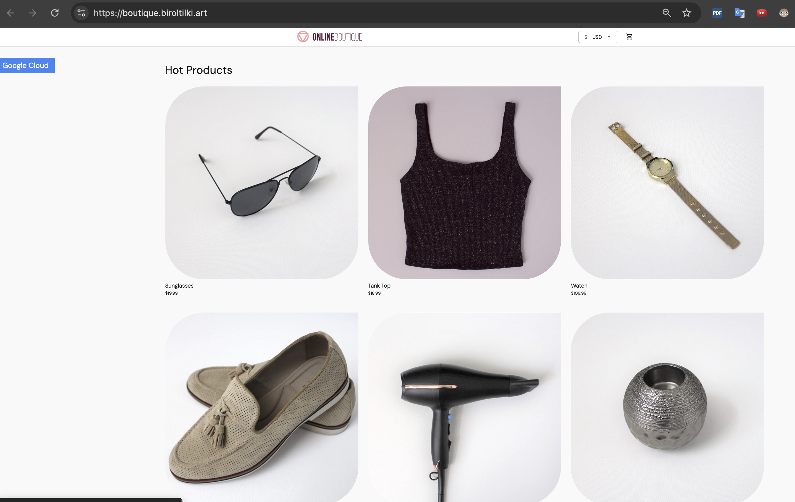

`https://boutique.biroltilki.art` over Google-managed TLS (when the pilot was live). Shows the public storefront. It does not show a successful checkout or a Cloud Armor block.

File: [`boutique-storefront-https.png`](../../assets/diagrams/boutique-storefront-https.png)

### Argo CD — applications Healthy / Synced

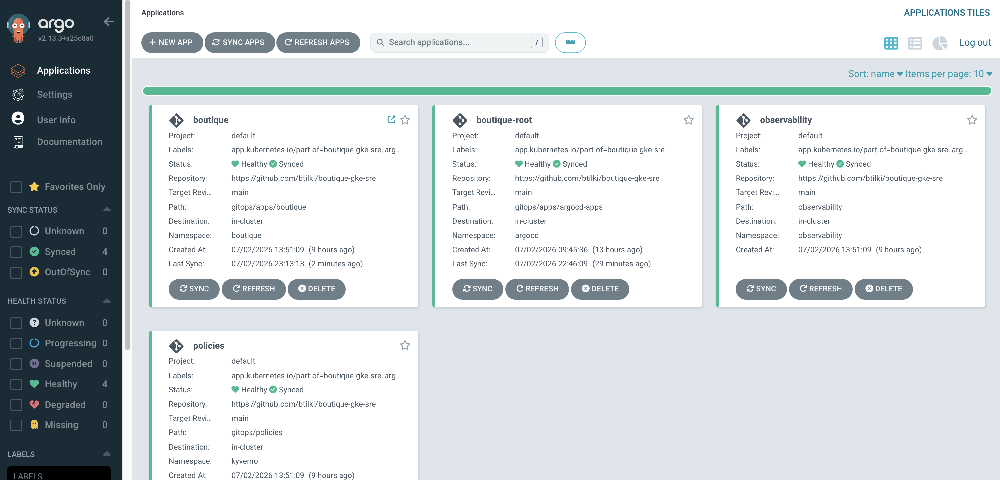

`argocd.boutique.biroltilki.art` — Boutique and platform apps Synced and Healthy at capture. Manual sync was the pilot rule. This crop does not show an OutOfSync app moving to Synced.

File: [`argocd-applications-healthy-synced.png`](../../assets/diagrams/argocd-applications-healthy-synced.png)

### GitHub Actions — build-scan-sign

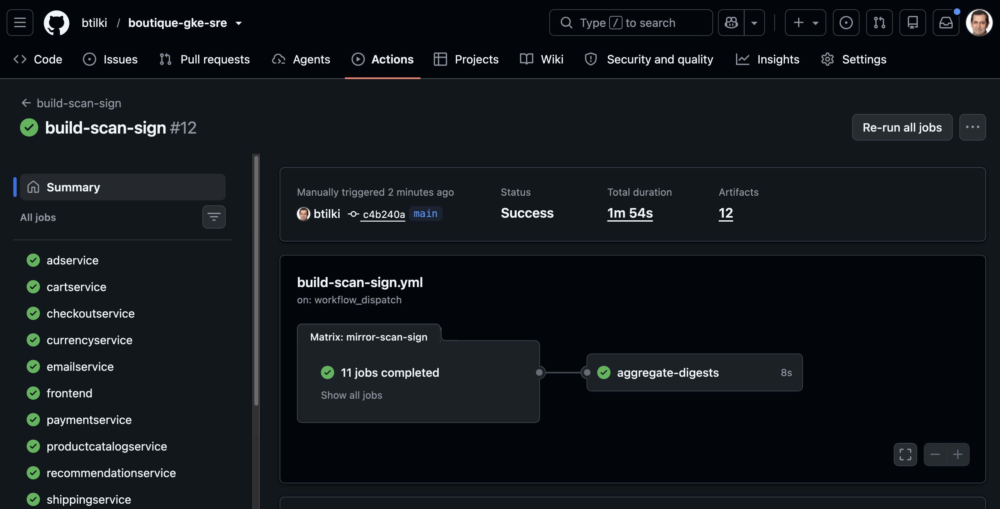

Green `build-scan-sign` run: Trivy → push to Artifact Registry → cosign. This crop does not show the digest PR diff or a Binary Authorization deny.

File: [`github-actions-build-scan-sign-success.png`](../../assets/diagrams/github-actions-build-scan-sign-success.png)

### GitHub Actions — Trivy gate (failure before baseline)

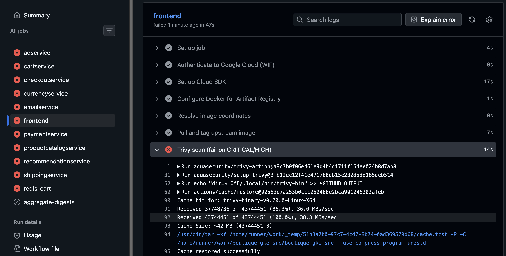

Trivy stopped the pipeline on critical/high findings before the upstream-mirror ignore baseline was in place. Shows that the scan gate can fail the job.

File: [`github-actions-trivy-scan-failure.png`](../../assets/diagrams/github-actions-trivy-scan-failure.png)

### Cloud Monitoring — browse and checkout SLOs

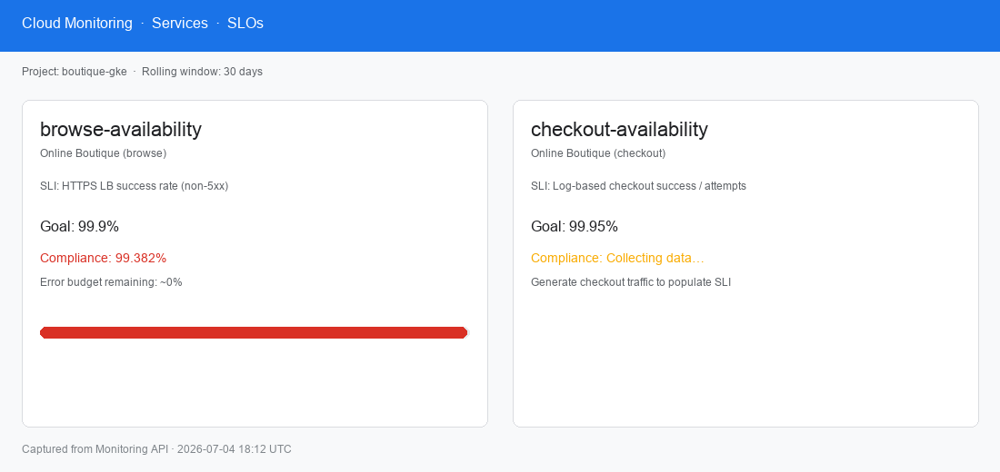

Availability SLOs for browse and checkout in Cloud Monitoring. Shows SLOs on the lived path. It does not show a multi-window burn chart firing.

File: [`slo-browse-checkout.png`](../../assets/diagrams/slo-browse-checkout.png)

### Burn alert — runbook link

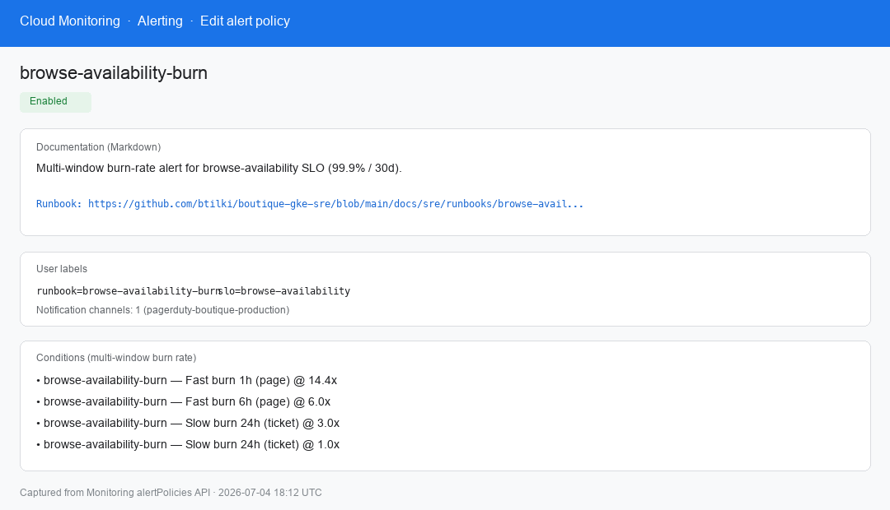

Alert policy documentation label with a runbook URL in this repository. Useful when a reviewer never opens PagerDuty.

File: [`alert-policy-runbook-link.png`](../../assets/diagrams/alert-policy-runbook-link.png)

### PagerDuty — Events API V2 and test incident

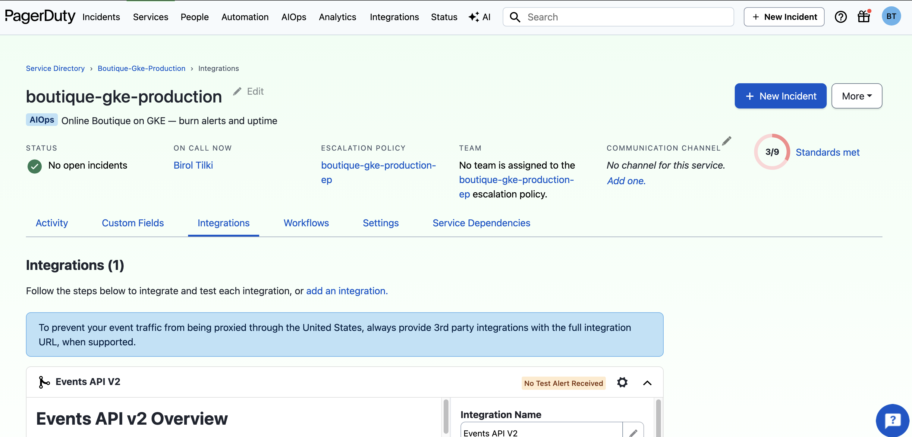

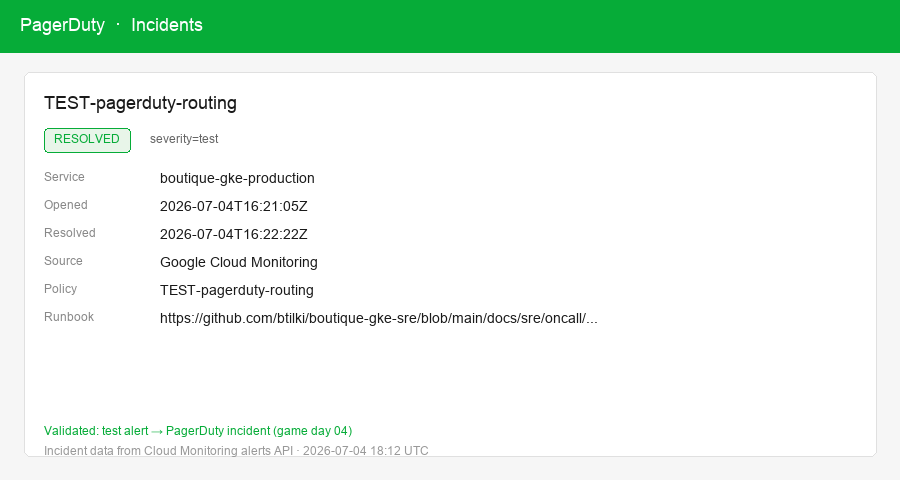

Service wired to Events API V2, plus a TEST alert that opened an incident. Shows routing on the pilot. It does not show a real SEV from live traffic.

Files: [`pagerduty-service-events-api-v2.png`](../../assets/diagrams/pagerduty-service-events-api-v2.png) · [`pagerduty-test-incident.png`](../../assets/diagrams/pagerduty-test-incident.png)

### Kyverno — five ClusterPolicies (Enforce)

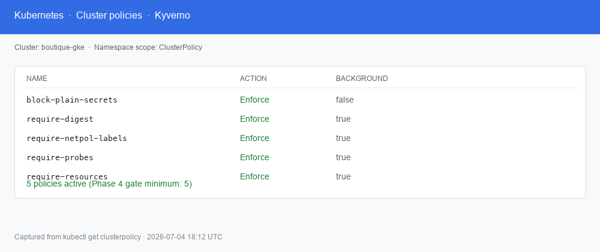

Digest-only images, probes, resources, NetworkPolicy labels, and ESO-only secrets in Enforce. This crop does not show a live deny of `:latest`.

File: [`kyverno-five-policies.png`](../../assets/diagrams/kyverno-five-policies.png)

### Binary Authorization — cluster admission

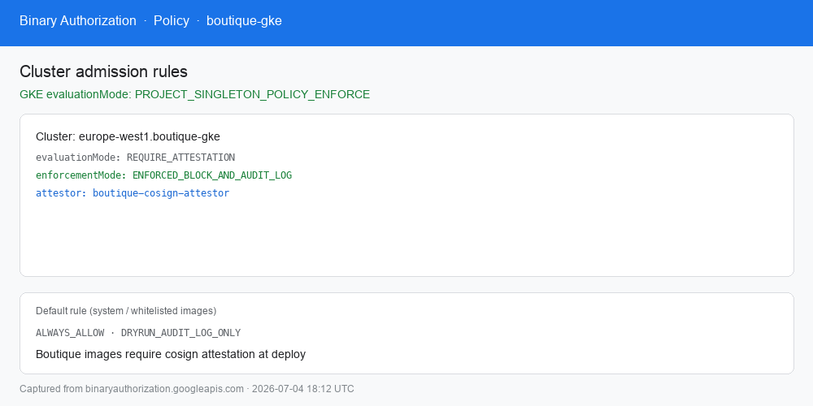

Cluster admission set for attested images. For the unsigned `redis-cart` restore gap, see [`SECURITY.md`](../../SECURITY.md) and the game-day postmortem under [`../sre/game-days/`](../sre/game-days/README.md).

File: [`binary-auth-enforced.png`](../../assets/diagrams/binary-auth-enforced.png)

### Cloud Armor — storefront edge

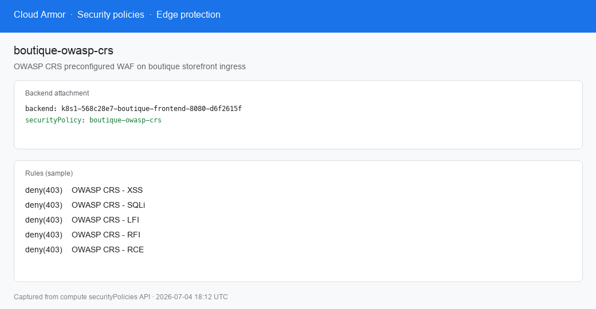

WAF on the storefront backend (topic 15, applied in the console). Does not prove every OWASP rule in a red-team run.

File: [`cloud-armor-ingress.png`](../../assets/diagrams/cloud-armor-ingress.png)

### Grafana and Cloud Trace

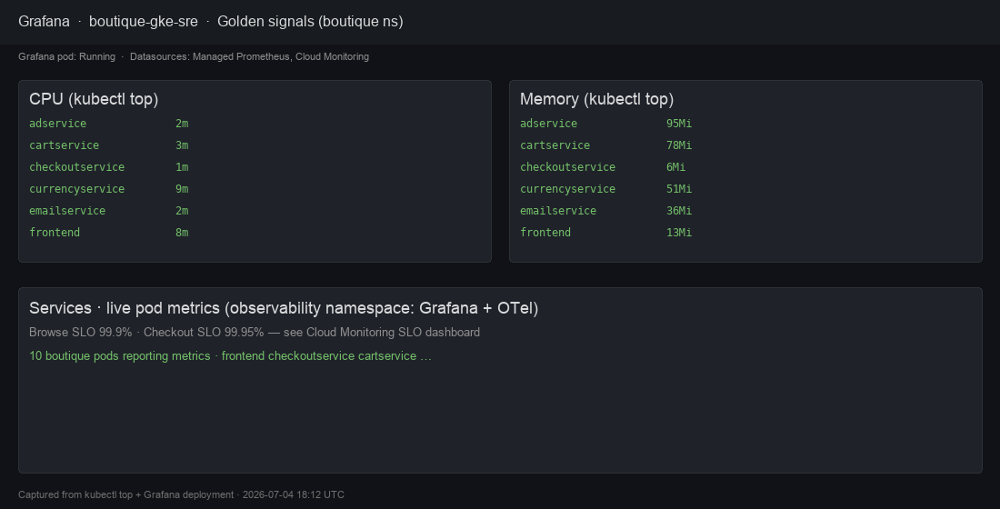

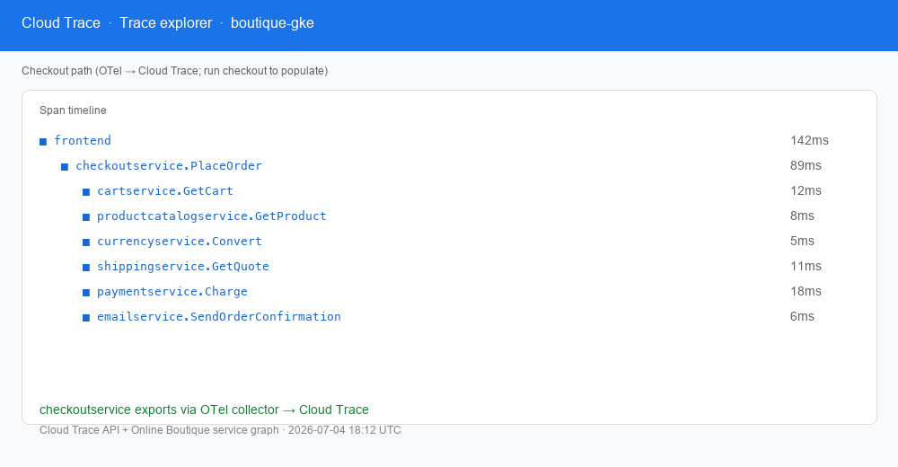

Grafana with boutique-namespace metrics, plus one checkout trace in Cloud Trace. Enough to show the observability path — not a full burn investigation.

Files: [`grafana-boutique-dashboard.png`](../../assets/diagrams/grafana-boutique-dashboard.png) · [`cloud-trace-checkout.png`](../../assets/diagrams/cloud-trace-checkout.png)

### Runbook lint

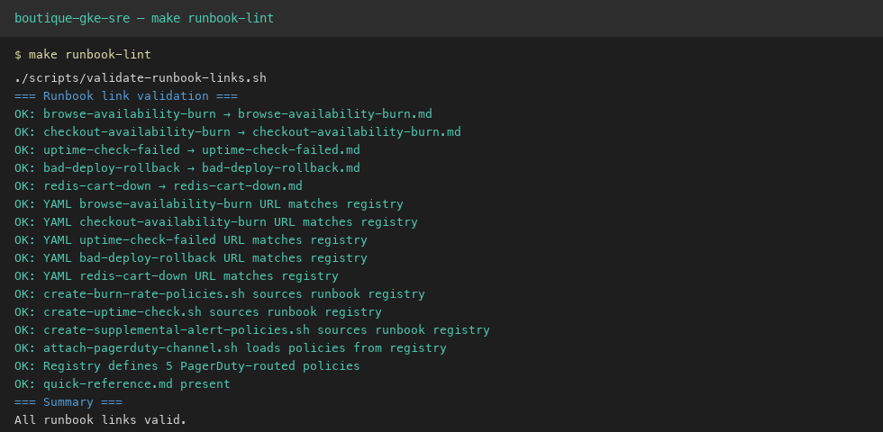

Local `make runbook-lint` success. Alert policy names and runbook files stay aligned in Git.

File: [`runbook-lint-success.png`](../../assets/diagrams/runbook-lint-success.png)

---

## Not shown yet

These items are documented, but there is no screenshot here yet. Capture them on a rebuild if you still need the proof on camera:

| Gap                                                | Why it matters                             |
| -------------------------------------------------- | ------------------------------------------ |
| Digest PR diff (image digest only)                 | Shows CI changed Git pins, not the cluster |
| Kyverno deny of `:latest` or a non-AR image        | Live admission on camera                   |
| Argo OutOfSync → manual Sync                       | Manual sync story on camera                |
| Binary Authorization deny on unsigned `redis-cart` | Matches the game-day restore gap           |
| Multi-window burn chart firing                     | SLO → alert path under load                |
| Teardown: `terraform destroy` / empty orphan scan  | Phase 8 on camera                          |
| Private endpoint / authorized networks             | Would close the public API tradeoff        |

Claims you can defend without a cluster: [`../pilot-claims.md`](../pilot-claims.md). Current limits: [`../../SECURITY.md`](../../SECURITY.md).

Same PNGs plus Mermaid sources: [`../../assets/diagrams/README.md`](../../assets/diagrams/README.md).

---

## Related

- Lessons from the pilot: [`../lessons-learned.md`](../lessons-learned.md)
- Rebuild: [`../setup/README.md`](../setup/README.md) (topics 01–16)
- Teardown: [`../teardown.md`](../teardown.md)
- Game days: [`../sre/game-days/`](../sre/game-days/README.md)
